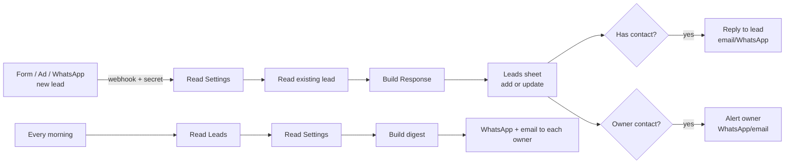

# How it works

*This page goes deep on purpose — it's the proof that the homepage summary is real and tested, not just copy.
You don't need to follow all of it to use the result.*

## The flow

All the business rules live in one file, `respond.js`. `build.js` copies it into the workflow's Code nodes, so the
rules that are tested are the same ones that run.

## After-hours rule

Business hours are Monday–Friday, 9:00–18:00 IST. The reply to the lead goes out **immediately, any time** —
that's the entire point of the workflow. The after-hours check only adds a flag for the owner alert and the morning
digest, so a human still follows up personally once the day starts, instead of the lead being forgotten.

## Flags

A row is always written, even when something's wrong, and the problem is spelled out in the `Flags` column and the
owner alert:

| Flag | Meaning |
|---|---|
| `Missing: name, what they're asking about` | Required fields the intake source didn't send |
| `No phone or email to reply to` | Can't send an instant reply — flagged instead of silently failing |
| `Arrived after hours – needs personal follow-up` | Came in outside business hours; the auto-reply still went out |
| `No owner set for team Sales` | Nobody in Settings to alert |

## When the same lead comes in again

The workflow matches on the intake source's lead/response ID.

- **It updates the row** rather than creating a duplicate.
- **The Status is never overwritten** — a lead marked `Contacted` stays `Contacted`.
- **The reply still fires again** on an update (e.g. the lead resubmitted with more detail), since that's cheap
  and better than silently skipping someone who tried again.

## Morning digest

- **Who it covers:** leads received in the last 24 hours.
- **What it flags:** anyone still `New` with an open flag — missing info, no contact method, or arrived after hours.
- **Why daily, not weekly:** speed-to-lead is an hours-scale problem, not a days-scale one; a weekly cadence (like
  CloseLoop's) would be too slow here.

## What's real and what's sample

- **Real:** the workflow, the rules, and their tests (`node respond.test.js`).
- **Sample:**
  - Every lead is invented. `send-test.sh` posts a generic lead-shaped sample.
  - The field names in `fromIntake()` are a starting point for five common sources (see
    [the mapping](intake-mapping.md)), not confirmed against any specific client's actual payload yet.
  - WhatsApp replies need a Meta-approved message template before the business can message a new contact first —
    that's Meta's rule, not a limitation of this workflow. Email is the reliable default until a template's approved.

## Files

| File | What |
|---|---|
| `respond.js` | All rules: intake field mapping, after-hours check, flags, reply text, owner alert, morning digest |
| `respond.test.js` | Fixed-date checks for every rule (`node respond.test.js`) |
| `build.js` | Builds `workflow.json` with `respond.js` inlined into the Code nodes |
| `workflow.json` | Import into n8n (no credentials inside) |
| `payloads/`, `send-test.sh` | Sample leads and the script that sends them |

## Build status

| Part | State |
|---|---|
| Rules (after-hours check, flags, digest) | Built and tested, in Node and inside n8n |
| Workflow in n8n | Built, generic intake webhook with a secret header |
| Email reply + alert + Sheet end-to-end | Logic tested (`node respond.test.js`); not yet run against a live Sheet/Gmail |
| WhatsApp reply/alert | Wired; WhatsApp replies need an approved message template (see above) |
| A real intake source | Sample payloads only — see [the field mapping](intake-mapping.md). Capture one real webhook payload per client and adjust `fromIntake()` |
